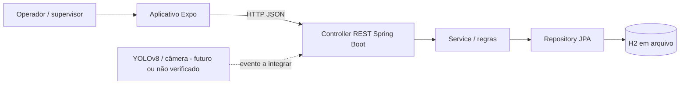

# Arquitetura final — Code&Ops / Metaindústria

**Natureza deste documento:** consolidação técnica preliminar, sujeita a conferência contra o código executável (ausente no ZIP recebido).

## Visão geral
Usuário no aplicativo Expo → serviços HTTP/Axios → API REST Spring Boot (camadas Controller, Service, Repository) → H2 em arquivo. Fluxo CRUD registra e consulta ocorrências de EPIs, permitindo rastrear data, EPI e status. Um módulo Python/YOLOv8 seria um produtor externo de eventos, **não comprovadamente integrado**.

## Decisões e justificativas
| Decisão | Motivo | Validação restante |
|---|---|---|
| API REST separada da interface | Reuso, testes e separação de responsabilidades | Inspecionar endpoints reais e contratos |
| Spring Boot e Java 17 | Organização por camadas, ecossistema de validação/JPA | Confirmar dependências no `pom.xml` |
| H2 em arquivo | Persistência simples sem servidor externo para avaliação | Demonstrar registros após reinício |
| Expo e React Native | Experiência móvel multiplataforma | Executar num emulador e aparelho |
| Axios em `src/services/` | Centralizar base URL, falhas e integração | Conferir implementação e ausência de mocks |
| Python/YOLOv8 (proposta histórica) | Detecção de EPIs baseada em imagem | Comprovar modelo, métricas, latência e ligação ao CRUD antes de afirmar operação |

## Modelo lógico proposto (validar campos reais)
`Ocorrencia`: `id`, `dataHora`, `setor`, `tipoEpi`, `descricao`, `status`, `observacaoTratamento` e referências a colaborador, se houver autorização e modelagem. Chaves, validações, tipos, relacionamentos e estados exigem alinhamento com as entidades reais. Dados demonstrativos devem ser claramente marcados como sintéticos.

## Contrato e qualidade
- Endpoints e payloads devem ser transcritos do código e validados via curl/Postman.
- Exibir estado de loading, sem dados, sucesso e indisponibilidade da API.
- CORS somente para origens necessárias quando aplicável; não expor H2 Console publicamente.
- Não colocar dados pessoais nem segredos no repositório.
- No fluxo de tratamento, resolver uma ocorrência **não** significa reclassificar automaticamente o colaborador como APTO.

## Limites
O ZIP documental recebido não inclui `pom.xml`, `package.json`, controllers, entidades, testes, modelo YOLO ou evidência de execução. Não é possível atestar integração, autenticação, detecção de 6 EPIs, precisão >90%, alertas reais, nem prontidão para produção.

## Fontes internas
`REQUISITOS.md`, `DICIONARIO.md`, `docs/sprint3/ARQUITETURA.md`, `docs/sprint3/PRODUCT_BACKLOG.md`. As afirmações históricas precisam ser reconciliadas com a implementação final.
